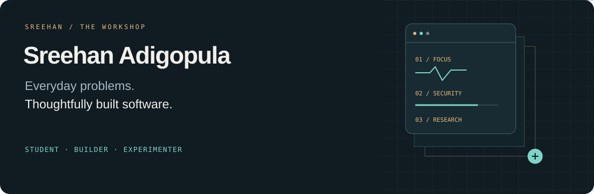
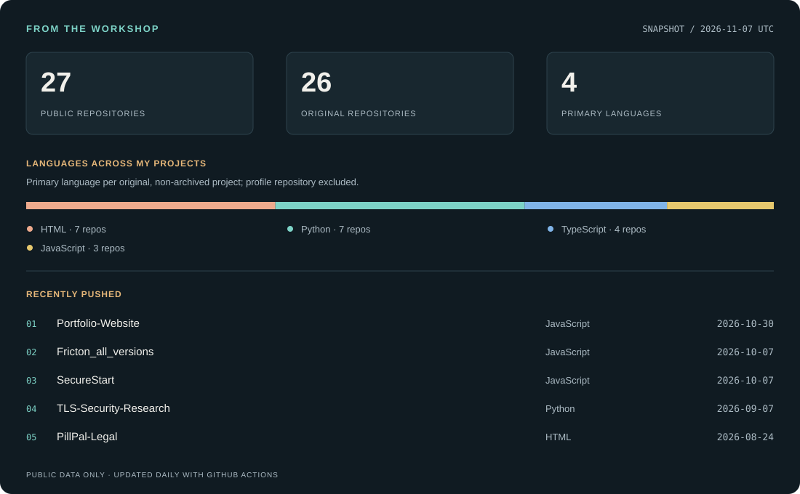

  

  <a href="#selected-work">Selected work</a> &nbsp; / &nbsp;
  <a href="#public-activity">Public activity</a> &nbsp; / &nbsp;
  <a href="https://github.com/SreehanAdigopula?tab=repositories">All repositories ↗</a>

## Hey, I'm Sreehan.

I'm a high school senior who builds software around problems I run into: staying focused, making cybersecurity easier to understand, and testing ideas with machine learning.

My projects range from a hand-drawn study app to a TLS classification experiment. I like taking an idea through the interface, the implementation, and the testing—and explaining what it can actually do.

### Selected work

<table>
<tr>
<td width="50%" valign="top">
<h3>01 &nbsp; Friction</h3>

<strong>A study space that adapts to your focus.</strong>

A hand-drawn student focus app with an adaptive timer, break and distraction tracking, a growing pet buddy, study media, and a Thought Parking Lot.

<code>JavaScript</code> <code>HTML / CSS</code> <code>Browser storage</code>

<a href="https://friction-brown.vercel.app">Try Friction ↗</a> &nbsp; · &nbsp; <a href="https://github.com/SreehanAdigopula/Fricton_all_versions">Explore the code</a>

</td>
<td width="50%" valign="top">
<h3>02 &nbsp; SecureStart</h3>

<strong>Clear next steps for everyday security.</strong>

A readiness checklist for small organizations, with transparent scoring, practical recommendations, local assessment history, and downloadable reports.

<code>JavaScript</code> <code>HTML / CSS</code> <code>Vercel</code>

<a href="https://securestart-lemon.vercel.app">Try SecureStart ↗</a> &nbsp; · &nbsp; <a href="https://github.com/SreehanAdigopula/SecureStart">Explore the code</a>

</td>
</tr>
</table>

#### 03 &nbsp; TLS Security Research

**Can observable TLS features help classify a website's configuration?**

A Python experiment using logistic regression, 12 measurable features, grouped evaluation, and an OpenSSL-based live probe. The repository includes the dataset, reproducible results, and an explicit discussion of limitations.

`Python` `scikit-learn` `OpenSSL` &nbsp; · &nbsp; [Read the research ↗](https://github.com/SreehanAdigopula/TLS-Security-Research) &nbsp; · &nbsp; [Methodology](https://github.com/SreehanAdigopula/TLS-Security-Research/blob/main/docs/methodology.md)

<strong>More from my workshop</strong> — AI applications, experiments, and earlier work

| Project | What I explored |
| :-- | :-- |
| [CrownScore](https://github.com/SreehanAdigopula/CrownScore) | Guided scalp photo check-ins with browser-based computer vision and progress tracking. An educational prototype, not a diagnostic tool. |
| [ClarifAI](https://github.com/SreehanAdigopula/ClarifAI_Sreehan) | AI-guided conversation support, private rooms, and a real-time discussion flow. |
| [PillPal legal pages](https://github.com/SreehanAdigopula/PillPal-Legal) | Public legal and privacy pages for the PillPal app. |
| [Minecraft guide](https://github.com/SreehanAdigopula/minecraft) | An earlier web project about a game I enjoy. |

[Browse the full collection →](https://github.com/SreehanAdigopula?tab=repositories)

### Tools I build with

**Web** &nbsp; JavaScript · TypeScript · React · Next.js · HTML · CSS  
**Research** &nbsp; Python · scikit-learn · OpenSSL  
**Workflow** &nbsp; Git · GitHub · Vercel · automated tests

### Public activity

Generated from my public repositories. Scheduled to refresh daily; snapshot date is shown above. Language counts reflect each repository's primary language. GitHub's contribution graph below shows contribution activity.

---

<strong>Start with a small problem. Build something useful.</strong> Thanks for taking a look around.

